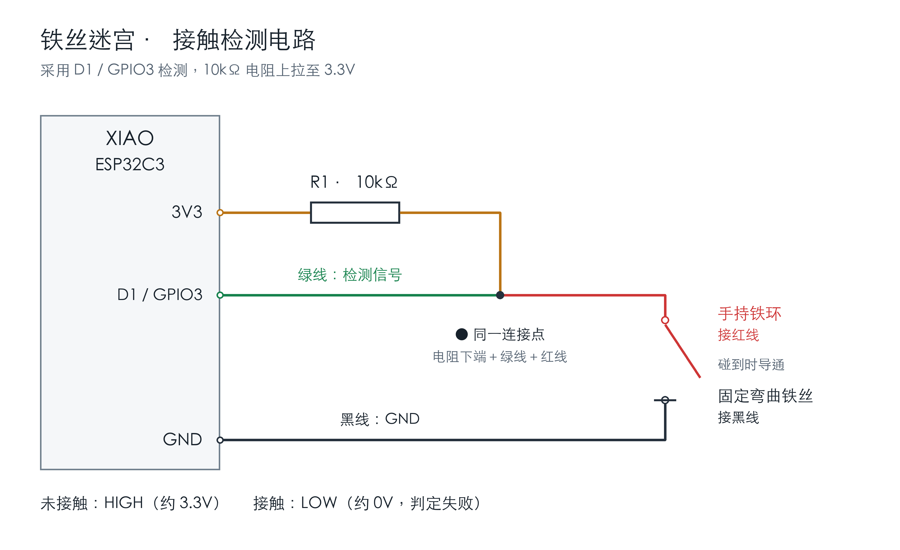

# ESP32 SDK · 铁丝迷宫接触检测

用于 **Seeed Studio XIAO ESP32C3** 的接触检测项目，包含开发板程序、本机 USB 串口服务、完整网页、电路图和使用说明。

铁环和铁丝分开时，整个页面显示绿色；接触时显示闪烁红色。连续分开 **200 毫秒**后恢复绿色，不需要点击重新开始。



## 硬件

- XIAO ESP32C3 开发板。
- 一根支持数据传输的 USB-C 线。
- 10kΩ 电阻、面包板、连接线。
- 固定的裸金属弯曲铁丝，以及带导电铁环的手持棍。

| 连接 | 用途 |
| --- | --- |
| 3V3 → 10kΩ 电阻 → 检测节点 | 外部上拉 |
| 检测节点 → D1 / GPIO3，绿线 | 数字输入 |
| 检测节点 → 手持铁环，红线 | 接触检测的一端 |
| GND → 固定铁丝，黑线 | 接触检测的另一端 |

**电阻下端、红线和绿线必须相通。红线不能直接连接 3V3。** GPIO 使用 3.3V 电平。

完整说明见 [接线说明](docs/wiring.md)。图中的引脚排列为电路示意，不代表开发板的物理位置。

## 快速开始：开发板已装好本项目程序

当前本机程序支持 **macOS，Python 3.9 或更新版本**。浏览器无需安装插件，网页服务也不需要安装第三方 Python 依赖。

```sh
git clone https://github.com/DinoMax00/esp32_sdk.git
cd esp32_sdk
python3 maze-detector/web_server.py
```

打开 <http://127.0.0.1:8765/>。点击“进入全屏”或按 **F** 进入全屏，按 Esc 退出。

- **绿色**：未接触。
- **闪烁红色**：已接触。
- **等待连接**：USB 未连接，或超过 3.5 秒没有收到有效检测数据；重新连接后自动继续。

默认自动选择 `/dev/cu.usbmodem*`。只有一个开发板时可以直接使用；有多个设备时请明确指定串口：

```sh
ls /dev/cu.usbmodem*
python3 maze-detector/web_server.py --serial /dev/cu.usbmodem1101 --port 8765
```

用 Ctrl+C 停止服务。不要同时打开串口监视器、`mpremote` 或另一个检测服务，避免争抢串口数据。

> 当前串口桥接使用 macOS / POSIX 的 `termios`，不直接支持 Windows。网页前端可以在现代浏览器运行，但必须通过同一台电脑的本机服务读取开发板，不能直接双击 HTML，也不能只部署静态网页来代替 USB 服务。

## 第一次安装开发板程序

先关闭网页服务和其他串口工具，建立 Python 虚拟环境：

```sh
python3 -m venv .venv
source .venv/bin/activate
python -m pip install -r requirements.txt
ls /dev/cu.usbmodem*
```

将下面的串口名替换为自己的设备。**首次安装会替换板上的原有固件**；安装工具会先保存一份 4MiB Flash 完整备份，然后下载、校验并写入官方 MicroPython ESP32-C3 固件，最后上传 `main.py`。

```sh
python scripts/setup_board.py --port /dev/cu.usbmodem1101 --install-runtime
```

安装完成后运行网页服务：

```sh
python maze-detector/web_server.py --serial /dev/cu.usbmodem1101
```

使用固定版本 **MicroPython ESP32_GENERIC_C3 v1.29.0**。固件从官方站点下载，校验 SHA-256；固件缓存和设备备份不加入 Git。安装工具不会修改 eFuse。

若已经装有兼容的 MicroPython，只需上传检测程序：

```sh
python scripts/setup_board.py --port /dev/cu.usbmodem1101
```

下载固件但不访问开发板：

```sh
python scripts/setup_board.py --download-only
```

## 运行原理与参数

```text
铁环 / 铁丝接触
       ↓
ESP32-C3 D1 / GPIO3 → MicroPython 检测程序
       ↓ USB 串口（115200，逐行 JSON）
Python 本机服务 → SSE /events → 浏览器绿色 / 闪烁红色
```

开发板通过下降沿中断捕捉短暂接触，接触后立即报告。释放采用 200ms 确认，过滤晃动造成的短暂断开。接触次数只保存在内存中，重启清零。

在 [`maze-detector/main.py`](maze-detector/main.py) 顶部可调整：

| 参数 | 默认值 | 含义 |
| --- | --- | --- |
| `INPUT_GPIO` | `3` | D1 对应 GPIO3；不是 GPIO1 |
| `RELEASE_DEBOUNCE_MS` | `200` | 连续分开多久后报告未接触 |
| `HEARTBEAT_MS` | `1000` | 状态心跳间隔 |

网页每秒闪烁一轮；操作系统启用“减少动态效果”时显示静态红色。协议与接口见 [数据协议](docs/protocol.md)。

**防抖不能解决持续不导通的问题。** 铁环贴住铁丝但仍显示未接触时，请检查金属涂层、氧化、线头固定和面包板节点。排查步骤见 [常见问题](docs/troubleshooting.md)。

## 单独读取串口

先停止网页服务，再运行：

```sh
python maze-detector/monitor.py --port /dev/cu.usbmodem1101 --seconds 30
```

日志保存在 `maze-detector/logs/`，不加入 Git。

## 测试

测试使用模拟输入和伪终端，不访问真实开发板。Node.js 仅用于前端逻辑测试，不是运行网页的必需依赖。

```sh
python3 maze-detector/test_firmware.py
python3 maze-detector/test_web_server.py
node --test maze-detector/web/state.test.mjs
python3 scripts/test_setup_board.py
```

覆盖即时接触、200ms 释放确认、原始输入与防抖状态、串口分包、SSE 推送和断开连接。GitHub Actions 自动运行这些测试。

## 文件结构

```text
esp32_sdk/
├── README.md
├── requirements.txt
├── scripts/setup_board.py          # 固件下载、原固件备份、上传与校验
├── docs/
│   ├── images/                     # 电路图和页面截图
│   ├── wiring.md                   # 接线说明
│   ├── protocol.md                 # 串口 JSON 与 HTTP/SSE 接口
│   └── troubleshooting.md          # 接触不稳定、连接与恢复说明
└── maze-detector/
    ├── main.py                     # 开发板上的 MicroPython 程序
    ├── web_server.py               # 本机 USB → HTTP/SSE 服务
    ├── monitor.py                  # 独立串口监视工具
    ├── test_firmware.py
    ├── test_web_server.py
    └── web/
        ├── index.html              # 完整页面与 CSS
        ├── app.js                  # 实时连接与全屏操作
        ├── state.mjs               # 显示状态判断
        └── state.test.mjs
```


## 官方资料

- [Seeed Studio XIAO ESP32C3](https://wiki.seeedstudio.com/XIAO_ESP32C3_Getting_Started/)
- [MicroPython ESP32-C3 固件](https://micropython.org/download/ESP32_GENERIC_C3/)
- [esptool 使用说明](https://docs.espressif.com/projects/esptool/en/latest/esp32c3/)
